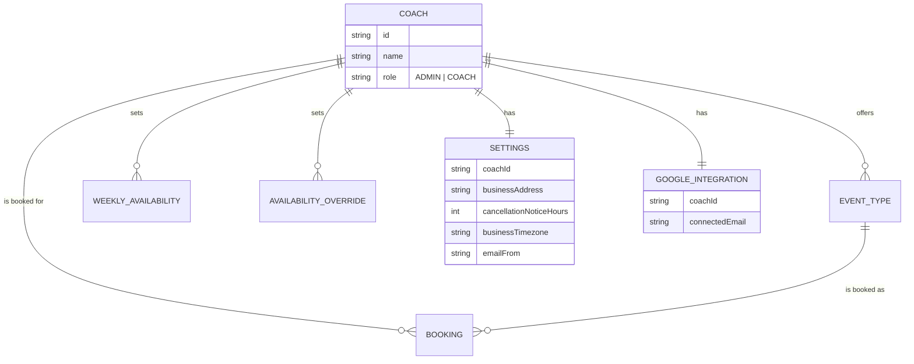

# Domain context: coach-calendar

Single-context glossary and data-model map for this repo (see `docs/agents/domain.md` for how agent skills consume this file). Kept up to date as the data model evolves -- this is the one place to look to see the current shape of the hierarchy.

## Standing decision: one website = one Coach, always

Every `Coach` is its own fully independent business -- there is no separate "tenant" or "studio" grouping above it, and there never will be (the earlier idea of a studio with several coaches sharing one tenant, managed by an `OWNER`, was explicitly rejected -- see backend issue #15's closing comment).

This used to be modeled as two tables (`Tenant` + `Coach`, 1:1), introduced while multi-coach-per-business was still an open question. Once that was ruled out, `Tenant` was merged back into `Coach` -- `Settings` and `GoogleIntegration` now key directly on `coachId`, and the `OWNER` role (and the cross-coach availability-conflict checks it motivated) was removed as dead weight.

## Glossary

- **Coach** -- both the bookable person AND the whole business: one website, one `Coach` row. Two roles:
  - **ADMIN** -- cross-platform "super admin". Sees/manages every Coach's data. Not scoped to its own account for authorization purposes.
  - **COACH** -- a single business's own account. Manages only its own calendar/event types/settings/bookings.
- **EventType** -- a bookable service a `Coach` offers (title, duration, locations, price). Scoped by `coachId`.
- **Booking** -- a client's appointment against one `EventType`/`Coach`. Scoped by `coachId`.
- **Settings** -- a `Coach`'s business profile (address, cancellation-notice window, timezone). One row per coach.
- **GoogleIntegration** -- the Google account used to mint Meet links for a `Coach`'s bookings. One row per coach. The platform's own OAuth app (`GOOGLE_CLIENT_ID`/`SECRET`) stays global, shared across every coach's own connection -- same pattern as e.g. a "Sign in with Google" SaaS using one OAuth app for many end users' own Google accounts.
- **Email sending** -- two mechanisms, chosen per send by `EmailService`: Gmail SMTP (the original mechanism, shared across every coach that hasn't set up their own) is the default/fallback; Resend is used instead once a coach verifies their own domain and sets `Settings.emailFrom`. Resend's free tier covers 3 verified domains (3,000 emails/month) -- a paid tier would be needed beyond that.
- **Public request resolution** -- there's no domain/subdomain-based routing: the two public, unauthenticated endpoints with no other coach context (`GET /event-types`, `GET /settings`) take an explicit, required `?coachId=` query param instead. Each frontend deployment is configured with its own `VITE_COACH_ID` and sends it on every public call -- "one backend serves many independent frontends", each one naming itself explicitly rather than being inferred from its hostname. `POST /bookings`, `GET /slots`, etc. never needed this: they always carry an `eventTypeId`/`manageToken` that already leads to a specific coach.
- **Booking email links, per coach** -- there's no global `FRONTEND_URL` anymore (removed): `Booking.originUrl` is stamped from the creating request's `Origin`/`Referer` header at `POST /bookings` time (see `common/origin.util.ts`'s `resolveRequestOrigin`, used in `BookingsController.create`), and every email about that booking (confirmed/cancelled/rescheduled) builds its links from that stored value instead of one site-wide setting. This is what makes a second coach's booking emails point at _their_ site instead of the first coach's.
- **Coach onboarding (invite flow)** -- a new coach is never created directly by an admin; the invite itself is what creates the `Coach` row, so there's never a half-formed account (email+name, no password) sitting in the DB. `POST /coaches` (admin-only; `email`, `name`, `frontendUrl`) mints a signed, 7-day, purpose-scoped token carrying the email+name (`TokenService.signCoachInviteToken`/`verifyCoachInviteToken`, same pattern as the Google-connect-state token) and emails an accept-link to it -- nothing is persisted, so re-sending (e.g. the first email got lost) is just calling it again. The invited coach submits a password to the public `POST /coaches/accept-invite`, which verifies the token and creates the `Coach` row for the first time with email+name+password together, then logs them in (same response shape as `POST /auth/login`). This invite email always goes out through the shared Gmail sender (see "Email sending" above), never via Resend -- a per-coach `Settings.emailFrom` can't exist yet for a coach that doesn't exist yet.

## Hierarchy

## Role reach, at a glance

| Action                                                            | ADMIN     | COACH    |
| ----------------------------------------------------------------- | --------- | -------- |
| View/manage own calendar, event types, availability, settings     | own only  | own only |
| View/manage **another coach's** calendar/event types/settings     | any coach | never    |
| Invite a new coach account / revoke a coach's sessions / list all | yes       | never    |
| Update own Settings / connect own Google Calendar                 | yes       | yes      |

## Backend issue tracker

| Area                                                                                    | Status      | Issue |
| --------------------------------------------------------------------------------------- | ----------- | ----- |
| Per-coach Settings                                                                      | ✅ Done     | #12   |
| Per-coach Google Calendar integration                                                   | ✅ Done     | #2    |
| Coach-aware email sending (Gmail fallback + per-coach Resend once a domain is verified) | ✅ Done     | #13   |
| coachId-based resolution for the public, unauthenticated endpoints                      | ✅ Done     | #14   |
| Multiple coaches sharing one business account                                           | ❌ Rejected | #15   |
| Guest/client user accounts for booking (future idea)                                    | 💭 Idea     | #16   |
| Coach id on queued notification jobs, for log observability                             | ✅ Done     | #17   |
| Invite-based coach onboarding (no global `FRONTEND_URL`, no pre-created account)        | ✅ Done     | #32   |

**Current real-world state:** the one existing coach hasn't verified a Resend domain yet (`Settings.emailFrom` is null), so it's still sending through the Gmail fallback -- this is expected, not a bug. Once a domain is verified at resend.com and `Settings.emailFrom` is set, email switches over automatically.

**Deploy status:** #14 and #17 are merged to `main` in both repos but **not yet deployed**. The frontend (betti-coaching) auto-deploys to Vercel on merge regardless -- safe, since the still-live production backend has no validation on the new `?coachId=` query param and simply ignores it. The backend itself (this repo, `coach-calendar` -- still deployed as the `betti-coaching-calendar` Cloud Run service, not yet renamed) is deployed to Cloud Run only when explicitly requested; until then, production keeps running the pre-#14/#17 code. A second coach/website still shouldn't go live before the backend deploy actually happens.
