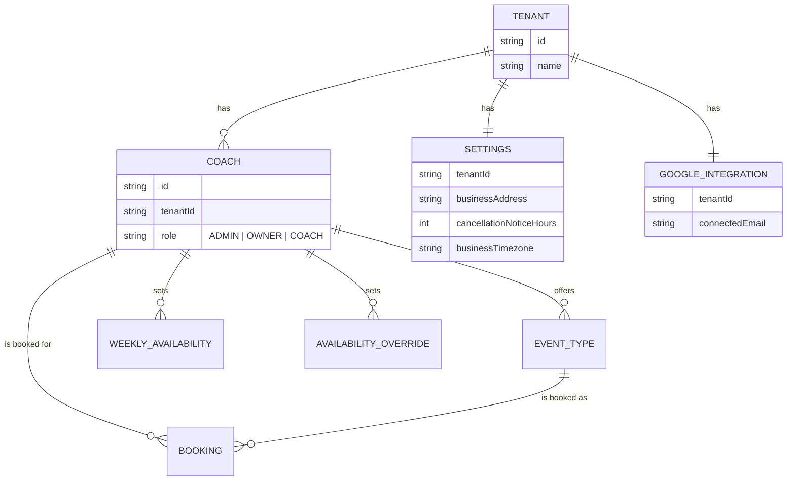

# Domain context: betti-coaching-calendar

Single-context glossary and data-model map for this repo (see `docs/agents/domain.md` for how agent skills consume this file). Kept up to date at the end of each multi-tenant migration task -- this is the one place to look to see the current shape of the hierarchy and what's still pending.

## Standing decision: one Tenant = one Coach, always

Decided explicitly: every `Coach` is its own fully independent business. A `Tenant` will never have more than one `Coach` under it -- the earlier "studio with several coaches, one OWNER managing them" idea (#15) is rejected, not just deferred (see #15's closing comment).

**Not yet acted on in code**, but this makes two already-shipped pieces effectively dead weight, worth simplifying away whenever this is next touched:

- The `OWNER` role and its account-management logic (`assertCanManageCoach`, the tenant-scoped branches of `CoachesService.findAll`/`create`/`revokeSessions`) -- an OWNER would never have another `COACH` in its own tenant to manage.
- `AvailabilityService.assertNoCrossCoachConflictForDate`/`ForWeekday` -- "other coaches in my tenant" is now always an empty set, so these checks can never actually find a conflict.

**Still open, not yet decided:** whether to collapse `Tenant` and `Coach` into one table (removes the `tenantId` indirection everywhere -- `Settings`/`GoogleIntegration`/`Settings.emailFrom` would key directly on `coachId`) or keep them as two tables with a 1:1 invariant enforced instead (less migration churn, keeps the already-built per-tenant extension-table pattern). Ask before picking one -- it changes the shape of every table below.

## Glossary

- **Tenant** -- one independent coaching business. The top-level isolation boundary: everything else hangs off a `tenantId`, directly or (for resources owned by a specific `Coach`) transitively.
- **Coach** -- a person who can be booked, and who may also hold account-management rights over other coaches in the same tenant. Always belongs to exactly one `Tenant`. Three roles:
  - **ADMIN** -- cross-tenant "super admin". Sees/manages every tenant's data. Not scoped by its own `tenantId`.
  - **OWNER** -- tenant-scoped manager. Same account-management actions as ADMIN (create a coach, revoke a coach's sessions) but only for `COACH`-role coaches within its own tenant, and never another coach's calendar/event types/availability/bookings. Also themselves a bookable `COACH`.
  - **COACH** -- plain bookable coach. No management rights over other coaches.
- **EventType** -- a bookable service a `Coach` offers (title, duration, locations, price). Scoped by `coachId`.
- **Booking** -- a client's appointment against one `EventType`/`Coach`. Scoped by `coachId`.
- **Settings** -- a `Tenant`'s business profile (address, cancellation-notice window, timezone). One row per tenant.
- **GoogleIntegration** -- the Google account used to mint Meet links for bookings. One row per `Tenant`, shared by every coach on it -- deliberately tenant-scoped, not coach-scoped, because coaches on one tenant already share one calendar (see the cross-coach availability-conflict rule). The platform's own OAuth app (`GOOGLE_CLIENT_ID`/`SECRET`) stays global, shared across every tenant's connection.
- **Email sending** -- two mechanisms, chosen per send by `EmailService`: Gmail SMTP (the original mechanism, shared across every tenant that hasn't set up its own) is the default/fallback; Resend is used instead once a tenant verifies its own domain and sets `Settings.emailFrom`. Resend's free tier covers 3 verified domains (3,000 emails/month) -- a paid tier would be needed beyond that.

## Hierarchy

## Role reach, at a glance

| Action                                                            | ADMIN        | OWNER                                 | COACH      |
| ----------------------------------------------------------------- | ------------ | ------------------------------------- | ---------- |
| View/manage own calendar, event types, availability               | own only     | own only                              | own only   |
| View/manage **another coach's** calendar/event types/availability | any tenant   | never                                 | never      |
| Create a coach account / revoke a coach's sessions                | any tenant   | own tenant, `COACH`-role targets only | never      |
| View the tenant's coach roster                                    | every tenant | own tenant                            | own tenant |
| Update tenant Settings (address/timezone/cancellation policy)     | any tenant   | own tenant                            | never      |
| Connect/check the tenant's Google Calendar integration            | any tenant   | own tenant                            | never      |

## Migration status (multi-tenant rollout)

Tracked as GitHub issues in this repo; update this table as each lands.

| Area                                                                                       | Status      | Issue |
| ------------------------------------------------------------------------------------------ | ----------- | ----- |
| `Tenant` entity, `Coach.tenantId`, `OWNER` role, cross-coach availability-conflict scoping | ✅ Done     | #11   |
| Per-tenant `Settings`                                                                      | ✅ Done     | #12   |
| Per-tenant Google Calendar integration (one shared Google account per tenant)              | ✅ Done     | #2    |
| Tenant-aware email sending (Gmail fallback + per-tenant Resend once a domain is verified)  | ✅ Done     | #13   |
| Tenant-aware `FRONTEND_URL`/domain resolution                                              | ⏳ Pending  | #14   |
| Multiple coach-users per tenant beyond ADMIN/OWNER/COACH                                   | ❌ Rejected | #15   |
| Guest/client user accounts for booking (future idea)                                       | 💭 Idea     | #16   |
| Tenant/coach id on queued notification jobs, for log observability                         | ⏳ Pending  | #17   |

**Current real-world state:** the one existing tenant hasn't verified a Resend domain yet (`Settings.emailFrom` is null), so it's still sending through the Gmail fallback -- this is expected, not a bug. Once a domain is verified at resend.com and `Settings.emailFrom` is set for that tenant, its emails switch over automatically.

**Known gap until #14 ships:** slots and booking creation/cancel/reschedule already resolve the right tenant correctly (they always carry an `eventTypeId`/`manageToken`, which leads straight to a specific coach and its `tenantId` -- no stopgap needed there). The real gap is the two endpoints with **no** booking/event-type context at all: the public event-types catalog (`EventTypesService.findActive()` returns every tenant's event types mixed together, unfiltered) and `GET /settings` (`SettingsService.getForPublicRequest()` -- an explicit, documented stopgap that returns "whichever tenant exists first"). Both need real domain-based tenant resolution from #14. **Don't onboard a second tenant before #14 ships.**
