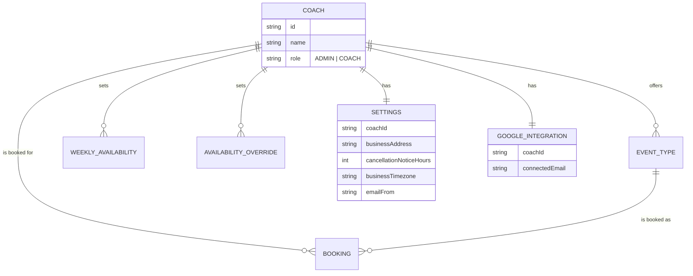

# Domain context: betti-coaching-calendar

Single-context glossary and data-model map for this repo (see `docs/agents/domain.md` for how agent skills consume this file). Kept up to date as the data model evolves -- this is the one place to look to see the current shape of the hierarchy.

## Standing decision: one website = one Coach, always

Every `Coach` is its own fully independent business -- there is no separate "tenant" or "studio" grouping above it, and there never will be (the earlier idea of a studio with several coaches sharing one tenant, managed by an `OWNER`, was explicitly rejected -- see backend issue #15's closing comment).

This used to be modeled as two tables (`Tenant` + `Coach`, 1:1), introduced while multi-coach-per-business was still an open question. Once that was ruled out, `Tenant` was merged back into `Coach` -- `Settings` and `GoogleIntegration` now key directly on `coachId`, and the `OWNER` role (and the cross-coach availability-conflict checks it motivated) was removed as dead weight.

## Glossary

- **Coach** -- both the bookable person AND the whole business: one website, one `Coach` row. Two roles:
  - **ADMIN** -- cross-platform "super admin". Sees/manages every Coach's data. Not scoped to its own account for authorization purposes.
  - **COACH** -- a single business's own account. Manages only its own calendar/event types/settings/bookings.
- **EventType** -- a bookable service a `Coach` offers (title, duration, locations, price). Scoped by `coachId`.
- **Booking** -- a client's appointment against one `EventType`/`Coach`. Scoped by `coachId`.
- **Settings** -- a `Coach`'s business profile (address, cancellation-notice window, timezone). One row per coach.
- **GoogleIntegration** -- the Google account used to mint Meet links for a `Coach`'s bookings. One row per coach. The platform's own OAuth app (`GOOGLE_CLIENT_ID`/`SECRET`) stays global, shared across every coach's own connection -- same pattern as e.g. a "Sign in with Google" SaaS using one OAuth app for many end users' own Google accounts.
- **Email sending** -- two mechanisms, chosen per send by `EmailService`: Gmail SMTP (the original mechanism, shared across every coach that hasn't set up their own) is the default/fallback; Resend is used instead once a coach verifies their own domain and sets `Settings.emailFrom`. Resend's free tier covers 3 verified domains (3,000 emails/month) -- a paid tier would be needed beyond that.

## Hierarchy

## Role reach, at a glance

| Action                                                        | ADMIN     | COACH    |
| ------------------------------------------------------------- | --------- | -------- |
| View/manage own calendar, event types, availability, settings | own only  | own only |
| View/manage **another coach's** calendar/event types/settings | any coach | never    |
| Create a coach account / revoke a coach's sessions / list all | yes       | never    |
| Update own Settings / connect own Google Calendar             | yes       | yes      |

## Backend issue tracker

| Area                                                                                    | Status      | Issue |
| --------------------------------------------------------------------------------------- | ----------- | ----- |
| Per-coach Settings                                                                      | ✅ Done     | #12   |
| Per-coach Google Calendar integration                                                   | ✅ Done     | #2    |
| Coach-aware email sending (Gmail fallback + per-coach Resend once a domain is verified) | ✅ Done     | #13   |
| Domain-based resolution for the public, unauthenticated endpoints                       | ⏳ Pending  | #14   |
| Multiple coaches sharing one business account                                           | ❌ Rejected | #15   |
| Guest/client user accounts for booking (future idea)                                    | 💭 Idea     | #16   |
| Coach id on queued notification jobs, for log observability                             | ⏳ Pending  | #17   |

**Current real-world state:** the one existing coach hasn't verified a Resend domain yet (`Settings.emailFrom` is null), so it's still sending through the Gmail fallback -- this is expected, not a bug. Once a domain is verified at resend.com and `Settings.emailFrom` is set, email switches over automatically.

**Known gap until #14 ships:** slots and booking creation/cancel/reschedule already resolve the right coach correctly (they always carry an `eventTypeId`/`manageToken`, which leads straight to a specific coach). The real gap is the two endpoints with **no** booking/event-type context at all: the public event-types catalog (`EventTypesService.findActive()`) and `GET /settings` (`SettingsService.getForPublicRequest()` -- an explicit, documented stopgap that returns "whichever coach was created first", correct only as long as there's exactly one website live). Both need real domain-based resolution from #14 before a second website goes live on this backend.
