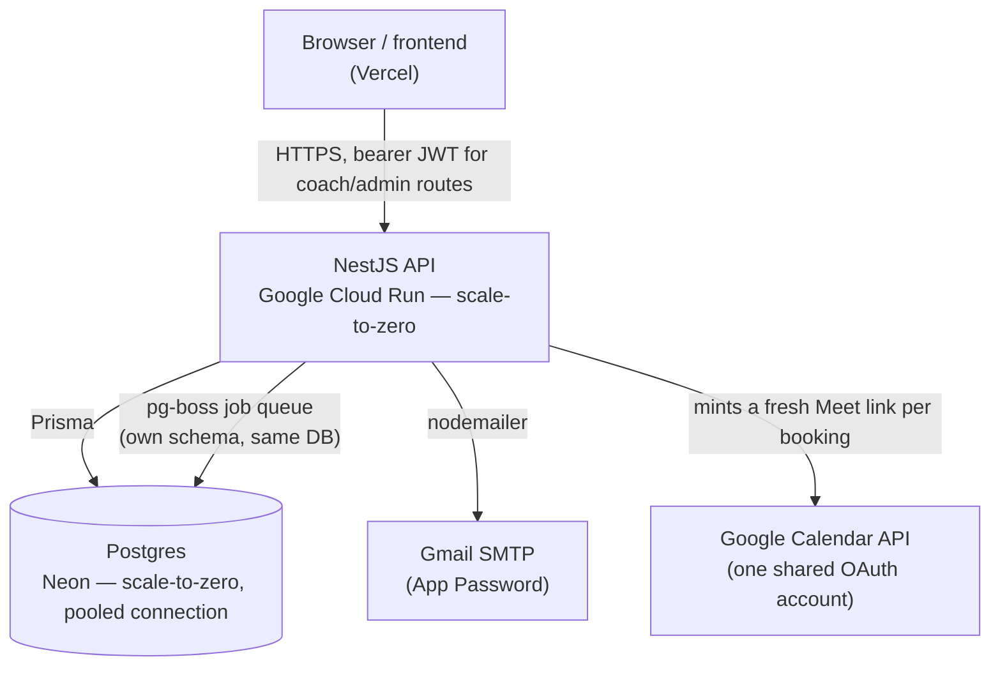
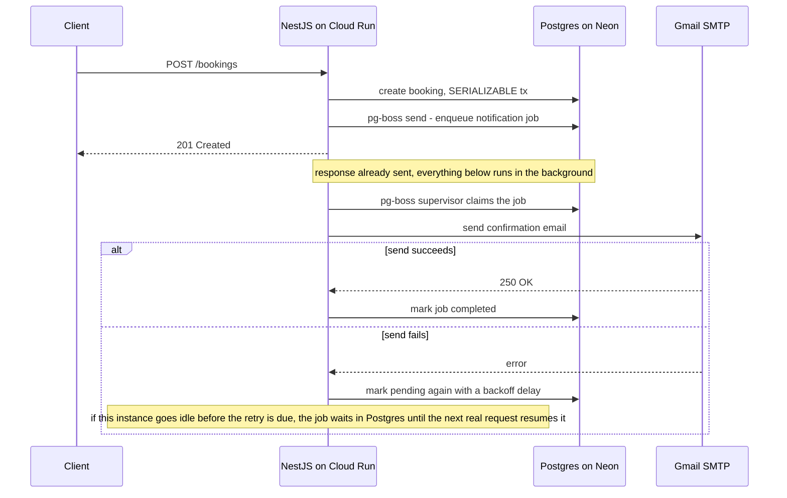

# coach-calendar

Booking/calendar backend API: coach accounts, event types, availability, and
bookings, shared by any number of independent coach websites — a
[NestJS](https://nestjs.com) project. Currently used by
[betti-coaching](https://github.com/gerencserjani/betti-coaching).

A single shared booking calendar: coaches each manage their own event types and
weekly availability, clients book without an account, and the whole thing is
modeled loosely on [cal.diy](https://github.com/calcom/cal.diy) (Cal.com's
open-source, MIT-licensed community fork) — much simplified for one frontend.

## System design



Every piece here is chosen to stay inside a generous free tier at this app's
traffic level, not because it's the "correct" way to build a booking system at
scale — see each section below for the specific trade-off accepted and why.
Nothing here needs Redis, a message broker, or an always-on server: the two
serverless pieces (Cloud Run, Neon) both bill for active compute time only,
and both scale to zero between real requests.

## Development

```bash
cp .env.example .env        # then fill in real values, see below
docker compose up -d        # starts Postgres
npm install                 # also runs `prisma generate` via postinstall
npm run db:migrate          # applies the schema to your local Postgres
npm run start:dev
```

The API listens on `PORT` (default 3000). `GET /health` is a plain liveness
check.

## API docs (OpenAPI/Swagger)

Interactive docs: `GET /docs`. Raw spec for tooling/agents: `GET /docs-json`
(also `/docs-yaml`) — generated automatically from the DTOs and controller
decorators (`@nestjs/swagger`'s Nest CLI plugin infers most of it from the
existing TypeScript types and class-validator decorators, no manual
`@ApiProperty()` annotation needed on request DTOs). Endpoints that require a
bearer token are marked `security: [{ bearer: [] }]` in the spec.

**Known gap**: response bodies aren't backed by dedicated DTO classes (they're
mostly raw Prisma model shapes returned straight from services), so response
schemas in the spec are generic (`type: object`) rather than fully typed.
Request bodies, query params, enums, and auth requirements are fully accurate
though — enough for a frontend/agent to know what to send and where.

## Testing

```bash
docker compose up -d                                  # Postgres must be running
createdb -h localhost -U betti betti_coaching_calendar_test  # once, if it doesn't exist yet
npm run test:db:setup                                  # applies migrations to the test DB
npm test                                                # unit + integration
npm run test:e2e                                        # full app, boots a real Nest instance
npm run test:cov                                         # unit + integration, with coverage
```

Tests run against a **dedicated Postgres database**
(`betti_coaching_calendar_test`), never the dev/production one — every test
file loads `.env.test` (dummy credentials, safe to commit) before anything
else, via `src/test/setup.ts`. `src/test/factories.ts` and
`src/test/prisma-test.util.ts` hold shared fixtures (`createTestCoach`,
`createTestEventType`, …) and a `resetDatabase()` helper that every
integration spec calls in `beforeEach`.

- **Unit tests** (`*.spec.ts` next to the file they cover, no DB) — pure
  functions and classes with their dependencies stubbed: crypto helpers, the
  i18n service, .ics/Google Calendar link builders, email content building,
  JWT signing.
- **Integration tests** (`*.spec.ts`, real DB) — services instantiated
  directly (`new BookingsService(testPrisma, ...)`) against the real test
  database, with only genuinely external dependencies (Google Calendar API,
  Gmail SMTP) mocked. `BookingsService`'s suite includes a real concurrency
  test — two `create()` calls racing for the same slot via `Promise.allSettled`
  — asserting the `SERIALIZABLE` transaction in
  `common/serializable-transaction.util.ts` lets exactly one win.
  `NotificationJobsService`'s suite runs against a **real pg-boss** instance
  on the test database (not a mock) with only `NotificationsService` stubbed,
  polling for a job to actually be picked up and processed, including a retry
  after a simulated transient failure.
- **e2e tests** (`test/*.e2e-spec.ts`) — the real `AppModule` booted with
  `@nestjs/testing`, driven over HTTP via `supertest`. Only `EmailService` is
  swapped for a stub (no real SMTP calls); everything else, including auth,
  guards, validation pipes, and the Prisma exception filter, runs exactly as
  in production. `@nestjs/throttler` is swapped for a trivial stub here too —
  not because rate limiting needs mocking, but because the real package (CJS)
  synchronously `require()`s `@nestjs/common` (ESM), which trips a Node.js
  restriction on circular `require(esm)` the moment the app boots under
  Jest's `--experimental-vm-modules` runtime. It's a Jest/Node ESM
  interoperability limitation, not anything specific to this app's code —
  see the comment in `test/jest-e2e.config.cjs` for the full story.

Both Jest configs set `maxWorkers: 1`: integration and e2e specs share one
real database and reset it per-test, so parallel workers would race and wipe
each other's fixtures mid-test.

### CI

`.github/workflows/ci.yml` runs on every pull request (and on push to
`main`): `npm run lint`, `npm run build`, `npm test`, and `npm run test:e2e`,
against a throwaway Postgres service container seeded with the same dummy
credentials already committed in `.env.test` — no GitHub secrets needed. This
is separate from `.github/workflows/release.yml` (semantic-release on push to
`main`, see "Releases" below), which doesn't run the test suites itself.

## Environment variables

See `.env.example` for the full list. Notes on the less obvious ones:

- **`DATABASE_URL`** — the local/test connection string; matches the
  credentials in `docker-compose.yml` out of the box. Also the fallback the
  app and the migration tooling both use whenever the two production-only
  vars below aren't set, since local/test Postgres has no pooled/direct
  distinction.
- **`DATABASE_POOLER_URL`** — production only. Neon's **pooled** (PgBouncer)
  connection string, with `?pgbouncer=true` appended. Used by the running
  app itself (`PrismaService`, `PgBossService`) for all normal
  queries/jobs. See "Production hosting" below for why.
- **`DATABASE_DIRECT_URL`** — production only. Neon's **direct**
  (non-pooled) connection string, used only for schema migrations (`prisma
migrate deploy`/`dev`, `prisma studio`) -- DDL isn't reliable through a
  transaction pooler.
- **`JWT_SECRET`** — signs the app's own login tokens (see "Auth" below).
  32+ random characters; generate with `openssl rand -base64 32`.
- **`GMAIL_USER` / `GMAIL_APP_PASSWORD` / `EMAIL_FROM`** — the default/
  fallback sender, used by any coach that hasn't verified its own domain
  (see `RESEND_API_KEY` just below). Sent through Gmail's own SMTP,
  authenticated as a real Gmail account: a third-party email API (Resend,
  SendGrid, …) can never send _from_ a `@gmail.com` address — only Google's
  own servers are authorized to (that's what SPF/DKIM enforce) — so this is
  the correct way to have `EMAIL_FROM` genuinely be a Gmail address. Turn on
  2-Step Verification on that Google account, then generate an **App
  Password** (not the account password) at
  [myaccount.google.com/apppasswords](https://myaccount.google.com/apppasswords).
  `EMAIL_FROM` must be `GMAIL_USER` itself, or a "Send mail as" alias
  configured on that account — Gmail SMTP rejects/rewrites a From address it
  doesn't recognize. Gmail's sending limit is ~500/day on a regular account,
  shared across every coach still on this fallback.
- **`RESEND_API_KEY`** — optional. Once set, a coach can verify its own
  sending domain at [resend.com](https://resend.com) (free tier: 3,000
  emails/month, 3 verified domains) and set `Settings.emailFrom` (via
  `PATCH /settings`) to a `"Name <address>"` at that domain — that coach's
  emails then go out through Resend as its own business, instead of the
  shared Gmail fallback above. See `EmailService` for the per-send
  Resend-vs-Gmail decision.
- **`ENCRYPTION_KEY`** — 32-byte, base64-encoded key used to encrypt the
  stored Google refresh token at rest. Generate with `openssl rand -base64 32`
  (a working dev value is already in `.env`, generate a fresh one for
  production).
- **`GOOGLE_CLIENT_ID` / `GOOGLE_CLIENT_SECRET` / `GOOGLE_OAUTH_REDIRECT_URI`**
  — from a Google Cloud OAuth 2.0 Client (type "Web application"), with the
  Google Calendar API enabled on that project.

## Auth

The app stores its own users — there's no third-party auth provider. A
`Coach` row has an `email` + bcrypt `passwordHash` + `role`
(`ADMIN` or `COACH`). `POST /auth/login` checks the password and returns a
JWT (signed with `JWT_SECRET`, 30-day expiry); send it as
`Authorization: Bearer <token>` on coach/admin routes (`JwtAuthGuard` in
`src/auth/`). `RolesGuard` + `@Roles(CoachRole.ADMIN)` additionally gate
admin-only routes.

There's deliberately no public self-signup and no `ADMIN_EMAIL`/
`ADMIN_PASSWORD` env vars — credentials never touch a `.env`/`env.yaml` file.
Instead:

- **The one admin account** is created by running `node scripts/seed-admin.mjs`
  once, interactively, against whichever `DATABASE_URL` you point it at (local
  or production) — it prompts for email/name/password and stores only the
  bcrypt hash.
- **Additional coach accounts are invite-based**, not created directly:
  1. An admin calls `POST /coaches` (admin-only; body: `email`, `name`,
     `frontendUrl` — the invited coach's own site, picked from a dropdown of
     already-allow-listed `AllowedOrigin` rows in the admin tool, used to
     build the accept link). This does **not** create a `Coach` row —
     there's no half-formed account sitting in the DB while the invite is
     unused. It only mints a signed, 7-day token
     (`TokenService.signCoachInviteToken`) carrying the email+name+
     frontendUrl, and emails it via the shared Gmail sender (see "Email
     sending" below — there's no per-coach `Settings.emailFrom` yet, since
     there's no Coach yet). Calling it again for the same email+site before
     it's accepted (e.g. the first email got lost) just sends a fresh link —
     nothing is persisted to collide with or clean up.
  2. The invited coach opens `<frontendUrl>/accept-invite?token=...` and
     submits a password to `POST /coaches/accept-invite` (public — they have
     no session yet). This verifies the token and creates the `Coach` row
     for the first time, with email+name+password+frontendUrl all together,
     then returns an access token (same shape as login) so the frontend can
     log them straight in.
  - Rejected (`404`) if `frontendUrl` isn't a known `AllowedOrigin`.
  - Rejected (`409`) if a `Coach` with that email already exists (at invite
    or accept time — covers both "already a coach" and replaying an
    already-used invite token), or if `frontendUrl` already belongs to
    another coach — **one coach per site**, enforced by `Coach.frontendUrl`
    being `@unique` (checked up front in `invite()`, and as the real
    race-safety backstop in `acceptInvite()` if two invites to the same site
    were both accepted around the same time). `AllowedOrigin` itself stays a
    separate, coach-agnostic CORS allow-list — `invite()` only reads it to
    validate the URL, there's no foreign key between the two tables.
  - `PATCH /coaches/:id/frontend-url` (admin-only) sets/corrects an
    _existing_ coach's `frontendUrl` after the fact, with the same two
    checks as `invite()` above. The one coach that actually needs this today
    is the seeded ADMIN account (see "The one admin account" below), which
    predates `invite()` and so never got a `frontendUrl` the normal way.

- **Forgotten password**: `POST /auth/forgot-password` (public; body:
  `email`) always returns `204` — silently, whether or not that email has an
  account, so it can't be used to enumerate which emails exist. For a real
  account, it emails a 1-hour reset link built from `coach.frontendUrl`
  (falling back to the request's own Origin/Referer header for a coach with
  none, e.g. the seeded ADMIN). `POST /auth/reset-password` (public; body:
  `token`, `newPassword`) verifies the token, sets the password, revokes
  every session issued before the reset, and returns an access token (same
  shape as login) so the frontend can log the coach straight back in. The
  link is single-use — replaying it is rejected the same way a revoked
  access token is.

`passwordHash` is also stripped from every JSON response as a defense-in-depth
measure (`StripPasswordHashInterceptor`, registered globally in `main.ts`),
so it can never leak even from an endpoint that includes a `coach` relation.

## One-time Google Calendar setup (mints fresh Meet links)

Every booking with location `GOOGLE_MEET` gets a **brand-new** Meet room, so a
previous client can never re-enter or linger in an old one. This uses a
single, centrally-connected Google account (yours in dev, the business
account in production) rather than a per-coach connection — see the ADR-style
reasoning in the conversation history if you need the "why".

1. In Google Cloud Console, create an OAuth 2.0 Client ID (Web application)
   with the Calendar scope, and set its redirect URI to
   `GOOGLE_OAUTH_REDIRECT_URI`.
2. Set the OAuth consent screen's publishing status to **"In production"**
   (not "Testing") — otherwise Google expires the refresh token after 7 days.
   Verification isn't required for a single internal account.
3. Visit `GET /admin/google/connect` directly in a browser (it 302s to
   Google's consent screen — not gated behind a login, since a plain browser
   navigation can't carry an `Authorization` header anyway; see the comment
   in `google.controller.ts`). You'll see an "unverified app" warning since
   the app isn't submitted for Google review — click "Advanced → Go to (app
   name) (unsafe)" to proceed; this is safe since you're authorizing your own
   app. Sign in with whichever Google account should mint the Meet links.
4. Google redirects back to `/admin/google/callback`, which stores the
   encrypted refresh token. `GET /admin/google/status` confirms the
   connection.
5. To switch accounts later (e.g. dev → production), just repeat step 3
   signed into a different Google account (or an incognito window) — it
   overwrites the stored token.

## Scripts

- `npm run start:dev` — start with hot reload
- `npm run build` — compile to `dist/`
- `npm run lint` — ESLint
- `npm run format` — Prettier
- `npm run db:migrate` — apply Prisma migrations (dev)
- `npm run db:generate` — regenerate the Prisma client after schema changes
- `npm run db:studio` — Prisma Studio, a GUI for the local database

## Architecture notes

- **Domain model**: each `EventType` (title/description/duration/locations)
  belongs to one coach. Bookable slots for an event type come only from that
  coach's own `WeeklyAvailability` + `AvailabilityOverride`. Clients never
  pick a coach explicitly — they just see a list of open times. `price`
  (whole HUF, never negative) is nullable with two distinct non-value
  meanings the frontend renders differently: `null` shows no price at all
  (e.g. a coach who prices things on a separate page of their own site),
  `0` shows "free" explicitly. `position` (display order in the public
  catalog, defaults to appended-at-the-end) is unrelated. Both are editable
  later via `PATCH /event-types/:id`.
- **Availability is purely per-coach**: `AvailabilityService` (`src/availability/`)
  only ever reads one coach's own `WeeklyAvailability`/`AvailabilityOverride`
  rows (`getEffectiveRangesForDate`) — there's no cross-coach exclusivity
  rule ("only one coach on duty at a time"). An earlier version of this app
  had one (back when multiple coaches could share one `Tenant`'s calendar,
  see `CONTEXT.md`'s "one website = one Coach" note); it was removed along
  with the `OWNER` role once that model was ruled out, since every coach's
  bookable hours are now independent.
- **Booking race safety**: `BookingsService.create`/`rescheduleByClient` wrap
  the availability + overlap check and the write in a single `SERIALIZABLE`
  Postgres transaction, retried a few times on serialization failure, so two
  simultaneous requests can never double-book the same slot.
- **Client-facing endpoints are public** (no login): `GET /event-types`,
  `GET /slots`, `POST /bookings`, and the whole `/bookings/manage/:token/*`
  self-service flow (cancel/reschedule via a random 32-char token emailed to
  the client, no login).
- **Coach/admin endpoints require a bearer token** from `POST /auth/login`
  (`JwtAuthGuard`, see "Auth" above). Admin-only routes additionally use
  `RolesGuard` + `@Roles(CoachRole.ADMIN)`.
- **Notifications**: nodemailer (Gmail SMTP) + React Email (`src/notifications/templates`),
  bilingual (hu/en) via a small i18next-based service reading flat-key JSON
  files from `src/i18n/locales/`, mirroring the frontend's own i18next setup.
  Every confirmation/reschedule email carries a `.ics` attachment (works in
  Apple/Outlook/Google) plus a Google Calendar "quick add" link. Sending is
  queued and retried, not fire-and-forget — see "Background jobs" below.
  `BookingEmail.tsx`'s letterhead name/tagline and light/dark color theme are
  per-coach (`Settings.brandName`/`brandTagline`/`emailBrandPalette`), not
  hardcoded — a coach with none set falls back to `DEFAULT_EMAIL_PALETTE`
  (Betti's own palette, mirrored from `betti-coaching/src/index.css`'s custom
  properties — the two are kept manually in sync, see the comment above that
  constant). See "Coach-branded booking emails" in `CONTEXT.md` for the full
  design.
- **Cancellation/reschedule**: only the client can reschedule (self-service);
  a coach can only cancel, with a mandatory reason. Both are blocked within
  `Settings.cancellationNoticeHours` (default 48h) of the appointment for
  client-initiated changes; coaches aren't bound by that window.

## Background jobs

Booking confirmation/cancellation/reschedule emails go through a durable
queue (`src/jobs/`), not a fire-and-forget async call. Why, and why it looks
the way it does, is worth documenting because the "obvious" answer
(Redis + BullMQ, or a cron-triggered worker) was deliberately rejected.

**Why a queue at all.** The old code sent email inline and swallowed failures
with `.catch(logger.error)`. If Gmail SMTP hiccuped, or the process got torn
down mid-send (which happens routinely on Cloud Run's scale-to-zero), the
email was just gone - nothing durable recorded the attempt.

**Why `pg-boss` and not Redis/BullMQ.** A queue is a table with a good
locking strategy (`FOR UPDATE SKIP LOCKED`) more than it's a new category of
infrastructure. [`pg-boss`](https://github.com/timgit/pg-boss) implements
that on top of the Postgres we already have - no new service to provision,
pay for, or keep patched. It also means enqueueing can never silently lose a
job the way a separate Redis call could: worst case, Postgres itself is down,
in which case nothing else in the app works either.

**Why there's no scheduler/cron driving it.** This was the actual design
question, worked through at length in this project's history - short
version:



A dedicated scheduler (Google Cloud Scheduler, or Neon's own Function
Triggers) was considered and dropped, for two reasons:

1. **It doesn't remove the real constraint.** Whoever calls the queue still
   has to query Postgres to do it, and that query is what keeps Neon's
   compute from auto-suspending. A scheduler polling every minute would burn
   through Neon's 100 CU-hour/month free allowance in days (continuous
   compute ≈ 720 hours/month vs. the 100-hour budget) - the trigger source
   doesn't change that math, only who initiates the same expensive query.
2. **`pg-boss`'s own retry policy doesn't need one.** `retryLimit: 3,
retryDelay: 5, retryBackoff: true` (see `notification-jobs.service.ts`)
   means a failed send is automatically retried a few times with growing
   backoff, for as long as the process instance that enqueued it happens to
   stay alive - which, immediately after a real request, it usually does for
   at least a little while. If it doesn't finish before the instance goes
   idle, the job's state is safely persisted in Postgres and resumes on the
   next real request, rather than being lost.

The accepted trade-off: **a failed send's retry timing isn't guaranteed** -
in the worst case (no traffic at all for a while) a retry waits for the next
real visitor. For a low-traffic booking site, and given the first attempt is
still synchronous/immediate on the happy path, this was judged an acceptable
cost for avoiding a second piece of paid/managed infrastructure. If traffic
or reliability requirements ever grow past this, the documented upgrade path
is either a Cloud Scheduler-triggered `/internal/process-jobs` endpoint, or
(if `pg-boss` itself becomes the bottleneck) a proper Redis-backed queue -
both are drop-in replacements for `NotificationJobsService`, not a rewrite of
`BookingsService`.

**Inspecting the queue.** [`@pg-boss/dashboard`](https://www.npmjs.com/package/@pg-boss/dashboard)
is a separate, standalone web UI for browsing queues/jobs/retries - it isn't
wired into the app itself, just run on demand:

```bash
npm run jobs:dashboard        # local dev DB, http://localhost:3010
npm run jobs:dashboard:prod   # production (Neon) DB, same URL, read-only
```

Only one at a time makes sense to look at, so switching is just stopping one
and starting the other. Port 3010 is deliberate - it avoids clashing with the
app's own dev server on 3000. The `:prod` variant sets
`PGBOSS_DASHBOARD_READ_ONLY=1` so it can't accidentally delete/retry a real
job; drop that env var locally if you actually need to manage a stuck
production job through the UI.

## Production hosting (Neon + Cloud Run)

The app is deployed as a container (`Dockerfile` at the repo root) to
[Google Cloud Run](https://cloud.google.com/run), backed by a free
[Neon](https://neon.com) Postgres database — both stay within their
always-free tiers at this app's traffic level. See the write-up on why these
two (and not Render/Railway/Fly.io) in the project conversation history if
you need the reasoning.

**Set `DATABASE_POOLER_URL` to Neon's pooled connection string, and
`DATABASE_DIRECT_URL` to the direct one** (used for migrations -- see
"Environment variables" above). Reasoning: Neon's compute scales to zero on idle, same as
Cloud Run. pg-boss holds a long-lived connection pool that polls every few
seconds in the background; when Neon suspends the compute out from under
that pool, pg-boss's connection drops and it has to reconnect, sometimes
repeatedly, before the compute fully stabilizes (seen in production as a
burst of `pg-boss error` log lines for several minutes after every cold
start). The pooled endpoint sits in front of the compute via PgBouncer and
doesn't itself suspend, so it absorbs that churn instead of the app seeing
it. It costs nothing extra on Neon's free tier -- billing there is CU-hours/
storage/transfer, not per-connection-type -- and it's not a paid-only
feature; it's always available, Neon just also needs you to use the direct
one for migrations, since the pooled one can't run DDL/session-level
operations reliably.

Run `bash scripts/setup-production.sh` **directly in Git Bash** (not via
PowerShell calling `bash`, and not through an AI-assistant's one-shot command
runner — it's fully interactive across 8 stages and needs a real TTY you can
type into) for a guided, re-runnable walkthrough: gcloud CLI setup, GCP
project/billing, Neon database creation, the Google OAuth client for Meet
links, the Gmail App Password, and the first `gcloud run deploy`. It writes secrets to
`.env.production` and `env.yaml` (both gitignored, kept separate from the
local-dev `.env`) and remembers what you've already entered if you stop and
re-run it. The very last thing it prompts for is running
`node scripts/seed-admin.mjs` against production — see "Auth" above.

### Redeploying

```
gcloud run deploy betti-coaching-calendar --source . --region europe-west1 --project <project-id>
```

The container no longer runs `prisma migrate deploy` on boot (that was
adding ~7-8s to _every_ cold start, not just deploys, for a check that's a
no-op almost every time). Whenever a deploy includes a new migration, apply
it once, separately, against production:

```
npm run migrate:prod
```

(reads `.env.production`, same pattern as `jobs:dashboard:prod` -- `prisma7.config.ts`
picks up `DATABASE_DIRECT_URL` from it automatically). Order doesn't matter
much either way, but migrating first means the new revision never serves
traffic against an old schema.

## Known follow-ups

- `npm audit` flags 4 high-severity advisories, all inside Prisma's own CLI
  tooling (`mysql2`/`deepmerge-ts`, pulled in even though we only use
  Postgres) — not reachable from the running app. `npm audit fix --force`
  would downgrade Prisma to 6.x; not done here on purpose.

## Releases

Versioning and releases are automated via [semantic-release](https://semantic-release.gitbook.io/) from [Conventional Commits](https://www.conventionalcommits.org/) on `main` (see `.github/workflows/release.yml`).
